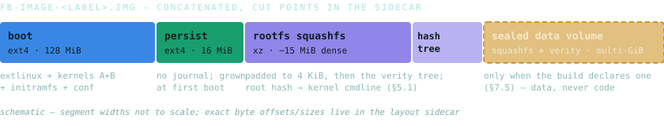
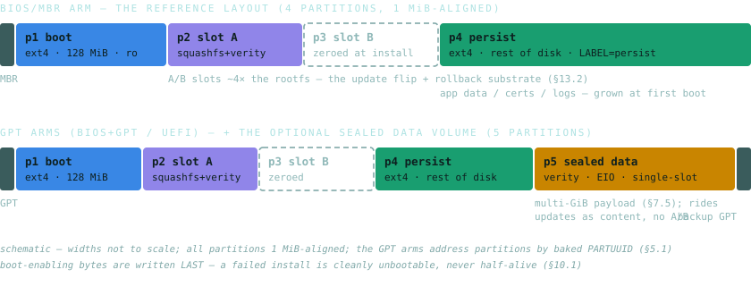

# Fruit Basket

> A rendered version of this paper is published at
> **<https://fruitvibes123.github.io/fruit-basket/>**.


*Engineering white paper — revision 1.4, August 2026.*

> [!WARNING]
> Every line of code and documentation in this repository — this paper included — is LLM
> output, written end to end by Claude (Anthropic) under the direction and review of a human
> operator. Read and reuse it with that provenance in mind.

A single-purpose, immutable, integrity-enforcing Linux appliance OS that hosts one
 directly web-exposed application on rented virtual infrastructure, optionally alongside confined local
 co-tenants that add no network listener (an AI-inference workload is the designed first case). Built from a pinned kernel, a read-only dm-verity rootfs,
 kernel-enforced code signing (IMA/EVM), two purpose-built Rust init systems, and a
 byte-reproducible build pipeline, with no configuration surface.

## About this repository

This repository is the published export of a private canonical repository, produced by an
equivalence-gated release tool. Three things follow for a reader:

- **The source is complete for reading, not for standalone building.** Several manifests carry
  path dependencies on an unpublished sibling library repository, and the build/deploy factory,
  the payload application, and the signing pipeline live in further unpublished repositories, so
  `cargo build` will not resolve here as checked out. The release gate proves that this exact
  source builds the shipped binaries — inside the pinned build container, with the sibling
  present.
- **Working comments are padded out, not deleted.** The export replaces internal non-doc
  comments with same-length whitespace, so the published source builds byte-identical binaries
  (compiler spans never move). Runs of trailing spaces and blank-looking lines are that padding;
  doc comments (`///`, `//!`) publish as written.
- **Every release commit carries its proof.** The release commit message records the canonical
  commit id and a gate witness list: per-file token-stream identity, doc-comment byte-identity,
  byte-identical built binaries for all nine shipped programs, per-workspace compile checks, and
  a content tripwire over every published byte, path, and the message itself.

## Contents

1. Introduction and design goals
1. Threat model
1. System overview
1. Kernel
1. Boot chain
1. Integrity architecture
1. Init and supervision
1. Networking and edge services
1. Persistence, crash recovery and rescue
1. Installation and deployment
1. Build pipeline and supply chain
1. Verification and assurance
1. Operations and lifecycle
1. Limitations and accepted residuals
1. Appendix A — kernel configuration pins
1. Appendix B — reference configuration
1. Appendix C — glossary

## 1. Introduction and design goals

Fruit Basket is an operating system for exactly one job: run a single network-facing application
on a rented virtual machine, and make the machine as close to incorruptible as the substrate
allows. It is not a general-purpose distribution. There is no package manager, no service the operator can
add at runtime, no configuration file the operator can edit on the box, and no shell-reachable
path that mutates the running system. The image that leaves the operator's build pipeline is,
byte for byte, the system that runs; the kernel enforces that equivalence continuously, not
just at boot.

For a small self-hosted service, the application itself is the realistic breach point. Hardening guides focus on the OS around the app, yet the OS
is usually a stock distribution with tens of thousands of mutable files, several privilege
domains the app never needed, and an update mechanism that is itself a remote-code-execution
surface by design. Fruit Basket inverts the posture. The OS assumes the application *will*
eventually be compromised and concentrates on making that compromise unrewarding:
nothing to persist into, nothing to lateral into, nothing to quietly modify, and a clean,
verifiable path back to a known-good state.

Four axes govern every design decision:

- **Privacy.** No third-party service participates in operating the box. TLS
 certificates come from an ACME CA via a client the operator builds; time, DNS, and backups stay
 within the operator's chosen trust boundary; telemetry does not exist.
- **Simplicity.** Narrow-by-construction beats configurable-by-default. Where a
 stock component would bring a large surface to use a sliver of it, Fruit Basket carries a small
 purpose-built one instead (two Rust init systems totalling a few thousand lines replace
 systemd/OpenRC; a ~1,000-line pure-Rust bootloader installer replaces a privileged five-tool
 chain).
- **Robustness.** Every failure path is enumerated and fail-closed. PID 1 never
 drops to a shell; a boot that cannot verify itself reboots; a persistence layer that cannot be
 safely mounted diverts to a recovery surface rather than guessing.
- **Security by construction.** Wherever possible, properties are enforced by
 types, file layout, or build-time assertion rather than by runtime discipline. The installer
 cannot write before verifying because the write functions require a token only the verify step
 produces. A kernel config regression fails the build, not the boot.

This paper describes the complete system: kernel, boot chain, integrity stack, init and
supervision, networking, persistence and recovery, the installer, the reproducible build pipeline,
and the verification methodology. It closes with the system's accepted limits.

## 2. Threat model

### 2.1 Application as the primary threat

The principal scenario is a remote compromise of the exposed application (or its TLS edge).
The attacker lands as the unprivileged application user inside a running box. The OS's job in
that moment is to bound the blast radius:

- **No persistence.** Everything executable lives on a read-only,
 cryptographically verified filesystem. The writable areas (`/run`, `/tmp`,
 `/persist`) are mounted `noexec,nosuid,nodev`, and the kernel additionally
 refuses to execute or executable-map any unsigned file. A dropped payload can occupy disk, but it
 cannot run after the exploited process dies, and cannot survive a reboot in executable form.
- **No escalation surface.** There are no setuid binaries of consequence, no
 sudo, no PAM, no cron, no package manager, no compilers or interpreters beyond a busybox
 `sh` that is itself signature-bound. Kernel module loading does not exist
 (`CONFIG_MODULES=n`), the BPF JIT is off, and `ptrace` is restricted to
 level 2 (admin-only).
- **Bounded egress.** Output filtering default-drops everything except DNS, NTP,
 and ports 80/443 (needed for ACME and OCSP). This is a speed bump, not a wall: an attacker can
 exfiltrate over 443, but it removes the convenient paths and is documented as
 such.
- **Cheap, trustworthy recovery.** Because the system is an image, recovery from
 suspected compromise is reinstall-from-known-bytes plus restore-of-data, not forensic
 cleanup.

### 2.2 Non-goals

The reference substrate is a rented KVM virtual server. The hypervisor — and on rented bare
metal, the BMC — sits below the OS and is controlled by the provider. No guest-side construction
can establish a sovereign hardware root of trust there, and Fruit Basket claims none:

- The box is treated as **sacrificial**. Its integrity stack raises the cost of
 compromise and guarantees detectability-by-divergence, but a hypervisor-level adversary is out
 of scope by definition.
- The boot partition (bootloader, kernel, initramfs) is necessarily mutable disk read by
 provider-controlled firmware. On the reference substrate the chain of verification therefore
 *starts* at the kernel + initramfs pair, not below it; how far down it reaches is an
 operator choice bounded by the substrate: where the host permits key enrolment, the operator can
 elect operator-enrolled UEFI Secure Boot (the custom *Rambutan* loader, §14) and push the
 root of trust beneath the kernel.

### 2.3 Two artifacts: box and pipeline

The architecture is split into **Fruit Basket** and the **pipeline**:

- **Fruit Basket protects the box** — runtime self-integrity, fail-closed boot, bounded
 post-compromise envelope — best-effort on hardware that cannot be sovereign.
- The **pipeline protects everything that matters more than the box**: the
 operator's signing keys, build environment, and private machines. Trust is rooted in
 operator-held keys that never live on the box. The flow of material is strictly one-directional
 — private side builds and signs, public side receives — and there is *no* channel from the box back into the private side. Backups are operator-*pulled*, and
 the box holds no credential that reaches any operator system (it cannot even initiate SSH;
 the SSH client is not in the image).

A fully-owned box — firmware and all — must give its
attacker nothing against the operator's private side. That isolation boundary, not the box's own
hardening, is the design's central security property.

### 2.4 Adversary class

Conspicuous hardening self-selects its adversary: opportunists move on, leaving the
motivated, capable attacker who treats breaking the design as the objective. The threat model
therefore assumes competence — 0-days against the app, supply-chain attempts against the build
inputs, and interest in the operator's machines. That assumption drives the pinned-and-verified
supply chain (§11), the air-gapped signing roadmap (§13.3), and the refusal to count on secrecy of
mechanism anywhere.

### 2.5 Substrate trust rungs

Because verification reaches only as far down as the substrate permits (§2.2), the floor a
deployment gets is an operator choice, not a fixed property of Fruit Basket. The same image runs on every
rung below; what differs is the substrate and a small amount of operator-elected wiring. From most
operator-sovereign to most rented:

- **Owned hardware, operator-controlled firmware.** UEFI with the operator's own
 enrolled PK/KEK/db (the companion *Rambutan* loader) pushes the root of trust beneath the
 kernel, and a discrete TPM measures the boot and seals secrets to that measurement. Verification
 roots in keys and silicon the operator physically holds. This is the one rung on which a firmware- or
 hypervisor-level adversary is not simply assumed out of scope.
- **Owned hardware, legacy BIOS.** No firmware key-enrolment, so verification
 starts at the kernel/initramfs pair (in-guest dm-verity + IMA); the operator holds the
 physical machine and no hypervisor sits beneath it — full physical custody, but no sub-kernel
 anchor.
- **A private cloud the operator runs.** An operator who runs their own OpenStack
 (or vSphere) *is* the substrate operator: they control the host firmware / OVMF variable
 store and enrol their own Secure Boot keys there, so the Rambutan chain roots in their keys even
 though the box is a guest. The tenant-facing "default keys only" limit of a rented cloud does not
 bind the host operator; on owned metal the hypervisor is theirs too, and this approaches the top
 rung. It fits an operator already running OpenStack who also wants Secure Boot.
- **A rented hypervisor that exposes operator-enrolled keys or a vTPM.** Some
 providers let a tenant supply their own PK/KEK/db (AWS Nitro via a registered variable store;
 Azure Trusted Launch via its key API), so the boot chain verifies against the operator's keys,
 but the firmware enforcing them and the hypervisor beneath stay the provider's: this is
 *enrolment, not sovereignty*. Where the platform offers a vTPM (Azure), it delivers
 measured boot, remote attestation, and secret-sealing rooted in the provider's attestation
 service. This suits an operator who has already accepted that provider into their trust base and
 wants Azure's vTPM alongside the box. It closes in-guest boot
 tampering; the hypervisor remains out of scope.
- **A rented hypervisor limited to BIOS or default-key Secure Boot.** No operator key-enrolment; verification rests on in-guest dm-verity + IMA and
 the box is sacrificial (§2.2). Default-key Secure Boot, where a host offers it, roots in a vendor
 CA and would reject the operator's own non-vendor-signed loader, so it is declined rather than
 adopted as a sovereignty downgrade (§14). The reference deployment lives here: it is the cheapest rung and makes no sovereignty claim it
 cannot meet.

Fruit Basket is identical across all five; only the substrate and the operator's elected anchoring
change. Two seams keep the ladder from fragmenting into five products: a key story that never
assumes *who* owns the Secure Boot keys — so the host-operator on a private OpenStack and the
tenant on AWS drive the same loader — and a measured-boot abstraction indifferent to whether the TPM
is a discrete chip or a hypervisor's vTPM, so the Azure rung and the owned-hardware rung share one
sealing-and-attestation path. Today Fruit Basket ships the chain for two rungs — operator-enrolled Secure
Boot, proven under OVMF, and the reference BIOS substrate; the TPM measured-boot path (the structural
close *Rambutan* defers, §14) and the per-substrate enrolment runbooks are named roadmap,
built when a concrete adopter stands on the rung. Those two seams keep the ladder usable as one design: the
operator picks the rung their substrate and threat model justify, and Fruit Basket mandates none of
them.

## 3. System overview

### 3.1 Artifact set

A build produces a reproducible artifact triple plus two boot artifacts kept outside the
image — and, when the artifact key set exists, detached signatures over all of them:

| Artifact | Contents | Role |
|---|---|---|
| `fb-image-<label>.img` | raw concatenation of the pre-baked partition components (see below) | everything the installer writes to disk |
| `….layout.toml` | byte offsets/sizes of the three components + firmware tag | parse-structure metadata only — *not* a trust anchor; the signature covers the image bytes, so a tampered layout produces a verification failure, not a bypass |
| `….sha256` | SHA-256 sidecars (one per shipped artifact) | transfer-corruption check on the staging target — integrity against accident, not against an adversary |
| `….vmlinuz`, `….initramfs` | the kernel and initramfs as standalone files | loaded locally by the deployment tool (via `kexec`) so the installer that runs is always the operator's copy, never bytes fetched from the target |
| `….img.sig`, `….vmlinuz.sig`, `….initramfs.sig` | detached ed25519 signatures, emitted whenever the operator's artifact-signing key set exists (§11.7) | operator-side authenticity over every shipped artifact; the same scheme's operator signature anchors restore-archive verification on the box (§9.5) |

Table 1. The build's output artifacts — the disk
image, its layout sidecar, the SHA-256 sidecars, the standalone kernel/initramfs, and the ed25519
signature sidecars — and the role each plays at install time.

The image itself is not a partitioned disk image but three independently-baked filesystem
images, concatenated, with a sidecar describing the cut points — four when the deployment declares
a *sealed data volume* (§7.5): a squashfs + dm-verity component carrying large read-only
payload data (the designed case is a multi-GiB AI-model file), baked and verified like the rootfs,
never executed from. The on-box installer creates the
partition table itself and copies each component into place:



Figure 1. The shipped `.img` — the boot,
persist-skeleton and rootfs components concatenated (plus the optional sealed data volume when the
build declares one), with a sidecar describing the cut points the on-box installer copies from.

Of the ~160 MB image, only ~43 MB is dense content. The boot component is baked at its full
128 MiB partition size because the copy-only installer (§10.1) writes ready-made filesystems and
never runs `mkfs`. The boot partition is sized for its steady state of *two*
~27 MB A/B kernels plus growth headroom, not its day-one content. The persist skeleton avoids the
same cost by shipping at 16 MiB and growing to fill its partition at first boot, and the rootfs
component ships at content size, not slot size (slot B is zeroed on the target, not shipped). The
mostly-zero image compresses to a fraction for transfer.

### 3.2 On-disk layout

The installer writes one of two firmware-selected layouts, fixed at build time. The reference
BIOS arm is a four-partition MBR layout, 1 MiB-aligned, all partitions type `0x83`; the
GPT arms (BIOS+GPT, and UEFI under the companion *Rambutan* loader) carry the same four
roles as GPT partitions — addressing disks beyond MBR's 2 TiB ceiling — plus, when the build
declares a sealed data volume, a fifth partition holding it (single-slot: payload data rides
updates as content, not as an A/B-flipped system):



Figure 2. The two firmware-selected on-disk layouts:
the four-partition MBR reference arm, and the GPT arms carrying the same roles plus the optional
fifth sealed-data partition. Slot B ships zeroed — the flip target of the update path.

- **A/B slots** hold raw rootfs components (no inner filesystem structure beyond
 the squashfs itself). The boot partition keeps both slots' kernels so an update can flip slots
 and roll back (§13.2). Slot sizes are
 generous (~4× the current rootfs).
- On the MBR arm, disks larger than MBR's 32-bit LBA limit (2 TiB) are rejected before any
 write; on every arm, disks too small for the required layout plus a minimum persist are rejected
 up front, before any write.
- Partition naming follows the kernel convention for both letter-ending
 (`vda2`) and digit-ending (`nvme0n1p2`) disk names; the GPT arms address
 partitions by baked PARTUUID rather than a deploy-time device token.

### 3.3 Software inventory

The userspace is assembled from eleven top-level packages of a pinned Alpine Linux release —
*extracted* into the image at build time, never installed (no package database, no
maintainer scripts, no package manager on the box): `musl`, `busybox` (+
`busybox-extras`), `dropbear` (server only — the SSH *client* is
deliberately absent), `haproxy`, `nftables`, `s6` +
`s6-portable-utils`, `libgcc`, `sqlite-libs`, and
`e2fsprogs-extra`. Everything else is first-party Rust:

| Component | Kind | Purpose |
|---|---|---|
| `initramfs-init` | static Rust binary, PID 1 (early) | verified-boot sequence; doubles as the installer when invoked with `fb.mode=installer` (§5, §10) |
| `box-init` | Rust binary, PID 1 (runtime) | bootstrap one-shots, network bring-up, services-vs-rescue branch, supervision hand-off (§7) |
| `app` | Rust binary, uid 100 | the payload web service (out of scope for this paper) |
| `fb-acme` | Rust binary, uid 101 | ACME HTTP-01 challenge server + certificate renewal client (§8.4) |
| `fb-backup`, `fb-cert-check` | Rust binaries | daily snapshot; daily certificate-expiry alarm (§8.5, §9.4) |
| `fb-oneshots` | Rust binary | the bootstrap one-shot toolbox `box-init` drives (hostname, first-boot CA and placeholder-certificate bootstrap, key staging, certificate reload) |
| `fb-update`, `fb-mark-good` | Rust binaries | the box-side A/B OS-update engine: manifest-verified update, two anti-rollback floors, inactive-slot write, boot-once probation, explicit acceptance (§13.2) |
| `fb-weights` | Rust binary | sealed-data-volume tooling (§7.5) |
| *the factory* | Rust CLI, operator host only | the build/deploy/verify tool — a separate repository that never ships on the box: it bakes the image from the pinned inputs, runs the deployment ceremonies, and owns the pin-store tooling (§10, §11) |
| *the service manifest* | TOML + a Rust schema crate | the validated declaration of the supervised topology — services, run privileges, restart caps, boot hooks, and confined-tenant resource domains (§7.3, §7.5); itself a pinned, hash-verified build input |
| `syslinux-install` | Rust crate (build-time) | privilege-free, deterministic bootloader installation into the baked boot filesystem (§11.4) |
| *host-key derivation* | a sibling library crate | HKDF derivation of SSH host keys and the kernel build seed (§9.3, §11.5) |

Table 2. The first-party Rust components — two init
systems, the payload and edge services, the operator CLI, and the build-time crates — that replace
a stock userspace.

The only C TLS stack on the box is OpenSSL, linked by HAProxy at the edge. All first-party
code uses rustls/RustCrypto. The Rust binaries are dynamically linked musl executables built
inside a pinned Alpine container — dynamic linking keeps the C-library surface to the one audited
`musl`, while the libc itself remains a swappable, source-pinned input rather than a
vendored blob.

## 4. Kernel

### 4.1 Source and configuration provenance

The kernel is mainline Linux **6.18.34**, fetched as a source tarball whose SHA-256
is pinned in the repository and cross-checked against kernel.org's PGP-signed checksum file. The
configuration is derived, not hand-rolled: the pinned Alpine release's `linux-virt`
config (a well-exercised KVM-guest baseline) is used as the base, a ~40-symbol hardening overlay is
merged onto it with the kernel's own `merge_config.sh`, and `make olddefconfig`
resolves the rest.

The resulting `.config` is then **asserted** against a pin
list before compilation begins. Kconfig dependency resolution silently drops symbols whose
dependencies aren't met — during development, `IMA_APPRAISE_REQUIRE_POLICY_SIGS` was
observed to vanish exactly this way until its four-symbol dependency chain was declared explicitly.
The assertion gate turns that whole failure class (including misspelled or phantom symbols) into a
build error instead of a silently weaker kernel. The full pin list is reproduced in
Appendix A.

### 4.2 Hardening posture

| Property | Mechanism | Note |
|---|---|---|
| No loadable modules | `CONFIG_MODULES=n` | the classic post-exploit kernel-implant vector does not exist; everything needed is built in |
| Lockdown, integrity mode, always | `SECURITY_LOCKDOWN_LSM(_EARLY)` + `LOCK_DOWN_KERNEL_FORCE_INTEGRITY` | compiled-in force — not dependent on a cmdline parameter surviving; `lockdown=integrity` is still passed on the cmdline as a backstop. Blocks `/dev/mem`-class access and unsigned runtime `kexec`, among others |
| Code-signing enforcement | `IMA` + `IMA_APPRAISE` + `REQUIRE_POLICY_SIGS` + `EVM` | §6 — the core integrity mechanism |
| Keyring trust restriction | `INTEGRITY_TRUSTED_KEYRING` chain | installs `restrict_link_by_digsig` on the `.ima`/`.evm` keyrings: only certificates signed by a key already in the kernel's built-in trusted keyring (the operator CA, embedded at build) can ever be loaded |
| ptrace restriction | Yama, `ptrace_scope=2` | set by init before any service starts; admin-only ptrace |
| No BPF JIT | `CONFIG_BPF_JIT=n` | removes the JIT-spray surface; nothing on the box loads BPF programs |
| Reproducible build | `GCC_PLUGIN_LATENT_ENTROPY` + pinned deterministic seed; `RANDSTRUCT_NONE` | the only build-time randomness source is driven by an HKDF-derived seed (§11.5), so the hardening plugin stays on *and* the kernel stays byte-reproducible; structure-layout randomisation is off because its seed cannot be externally pinned |
| IPv6 compiled in, refused at runtime | `CONFIG_IPV6=y` + `accept_ra=0` | deliberate: the firewall's unified inet table carries ICMPv6 rules that must load, so compiling v6 out would break the firewall load (which is fail-closed-to-reboot); autoconfiguration is refused instead. Managed IPv6 service is a defined but unbuilt seam |

Table 3. The kernel's hardening posture — each
property, the config symbol or mechanism that enforces it, and why it is pinned.

The functional set is exactly what the appliance needs and nothing more: ext4, squashfs
(xz, *with xattr support* — required so the kernel can read the signature xattrs, §6.3),
tmpfs, device-mapper + dm-verity, loop, virtio net/block, nftables, and the KVM paravirtual clock
(`KVM_GUEST` + `PARAVIRT_CLOCK` — pinned because the time-sync design, §8.6,
rests on kvm-clock being present). The production kernel is EFI-free; a UEFI variant — the
operator-selected alternative, booted by the custom *Rambutan* Secure Boot loader — is a
separate, now-implemented configuration (§14).

## 5. Boot chain

```
SeaBIOS ──▶ MBR stage-1 (440 B) ──▶ extlinux (boot ext4) ──▶ vmlinuz + initramfs
                                                                      │
                          cmdline: root-hash=… fb.verity-hash-offset=… fb.rootfs-dev=…
                                   ro lockdown=integrity ima_appraise=enforce
                                   sysctl.kernel.yama.ptrace_scope=2 fb.net=…
                                                                      ▼
kernel: loads operator leaf certs from initramfs /etc/keys/*.der onto .ima/.evm
        (link-restricted: must chain to operator CA in .builtin_trusted_keys)
                                                                      ▼
initramfs-init (PID 1, static Rust, panic=abort — every error ⇒ klog + reboot)
  1  mount /proc /sys /dev(devtmpfs) securityfs;  printk→7
  2  parse cmdline           (whitelist grammar; missing/invalid key ⇒ reboot)
  3  dm-verity table over fb.rootfs-dev  (raw device-mapper ioctls, vendored;
     restart_on_corruption)            → /dev/mapper/fb-root
  4  mount squashfs read-only at /sysroot
  4a load SIGNED IMA policy via securityfs  (fail-closed: a load that does not
     take is a panic — never a silently-unappraised boot)
  5  yama ptrace_scope → 2
  6  switch_root → /sbin/init  (box-init)
                                                                      ▼
box-init (PID 1, Rust)                                          [§7 in detail]
  mount /run /tmp (tmpfs, noexec,nosuid,nodev)
  bootstrap one-shots (firewall → persist recovery/mount → dirs → CA/cert → keys)
  static-IPv4 bring-up        ── any failure ⇒ rescue branch; firewall failure ⇒ reboot
  build tmpfs scan directory (symlinks onto the signed rootfs)
  exec s6-svscan  ──▶ supervision (8 services | rescue surface)
```

Figure 3. The boot sequence from firmware to
supervised services — SeaBIOS through the two purpose-built Rust init stages — with the
command-line contract and the verified hand-off it turns on.

### 5.1 Command line as contract

The kernel command line is baked into the boot partition's `extlinux.conf` at build
time, with the root-device token stamped in by the deployment tool. It carries everything the early
init is allowed to know:

- `root-hash=<64-hex>` — the dm-verity root digest of the rootfs.
- `fb.verity-hash-offset=<bytes>` — where, inside the rootfs partition, the
 squashfs ends and the hash tree begins. Rejected unless 4096-aligned (the build pads the
 squashfs so this always divides cleanly into a hash-block index).
- `fb.rootfs-dev=/dev/<name>` — the partition backing the rootfs.
 Whitelist-validated (`/dev/` + lowercase alphanumerics only — no slashes, no
 traversal). The box performs *no* disk detection at boot; device resolution happens on
 the operator side at deploy time, keeping discovery logic out of the trusted early-boot
 path.
- `fb.net=…` — the network configuration (§8.1). Deliberately classed as
 *non-integrity-critical*: a malformed value diverts to rescue, never to a default.
- `fb.weights-dev/-hash/-offset` — the sealed data volume's triple (§7.5), present
 only on a build that declares one, and parsed *all-or-nothing*: a partial set is a
 malformed contract and fails closed. The device token is always a baked GPT PARTUUID.
- The defence triple `lockdown=integrity ima_appraise=enforce
 sysctl.kernel.yama.ptrace_scope=2`, redundant with compiled-in enforcement by design.

Parsing is fail-closed: an absent or empty `root-hash`, a
misaligned offset, an unexpected device token — each is a reboot, never a guess or a default.
PID 1 has no shell to fall back to and no interactive mode; its only two exits are a successful
`switch_root` or `reboot(2)`.

### 5.2 dm-verity without userland glue

The verity device is constructed by speaking the device-mapper ioctl protocol directly; the
ioctl structures are vendored into the init with compile-time size assertions
(`size_of::<DmIoctl>() == 312`), each field verified against the pinned kernel's
`dm-ioctl.h`. There is no `veritysetup`, no `libdevmapper`, no
udev in the initramfs. The *rootfs* verity target is configured with
`restart_on_corruption`: any block whose hash fails to chain to the root hash reboots
the machine rather than returning EIO and limping on. A declared sealed data volume (§7.5) uses
the opposite mode — default EIO — because the failure semantics differ: a
corrupt *code* block means the system must not run, while a corrupt *payload data*
block is a typed read error one consumer handles, and rebooting on it would turn a damaged data
byte into a boot loop. Both trees are generated at build with `--no-superblock` and a
fixed salt (§11.6), so the on-disk tree is pure hash data at a known offset — nothing for the
init to probe or skip.

### 5.3 Verified hand-off

Before `switch_root`, the init loads the IMA appraisal policy (§6.2) and proves to
itself the load took: this is the one moment where enforcement could silently fail to arm, made
fail-closed. Only then does it replace itself with the runtime init from the now-verified rootfs.
From this point forward, every page of every executed file on the box is covered by either the
verity tree (integrity of the medium) or IMA appraisal (integrity of the inode), and almost always
both.

## 6. Integrity architecture

Four interlocking mechanisms together make "only
operator-signed code runs, and the medium it runs from cannot drift" a property enforced by the
kernel rather than by procedure.

### 6.1 Layered enforcement

| Layer | Covers | Failure behaviour |
|---|---|---|
| dm-verity | every 4 KiB block of the root filesystem — and of any sealed data volume (§7.5) — verified against a SHA-256 Merkle tree whose root is on the kernel command line | rootfs: reboot on first corrupt block (`restart_on_corruption`); data volume: EIO to the reader, box stays up (§5.2) |
| IMA appraisal | every `execve()` and every executable `mmap()` of a root-owned file, plus the policy file itself | `EACCES` — unsigned code does not run |
| EVM (portable signatures) | the security xattrs and file metadata (mode, uid/gid) that IMA relies on | appraisal failure — a re-signed or permission-tampered inode is refused |
| Mount policy + lockdown + no-modules | everything writable; the kernel itself | `noexec` on all writable mounts; no module loading; lockdown integrity blocks kernel-image modification paths at runtime |

Table 4. The four integrity layers — what each
covers and how each fails closed — that together enforce "only operator-signed code runs, from a
medium that cannot drift."

### 6.2 Appraisal policy

The complete IMA policy is three lines:

```
appraise func=BPRM_CHECK fowner=0 appraise_type=imasig
appraise func=MMAP_CHECK fowner=0 appraise_type=imasig
appraise func=MODULE_CHECK appraise_type=imasig
```

Every execution and executable mapping of a root-owned file must carry a valid digital
signature in its `security.ima` xattr. A build-time guard keeps this policy total
over code: every *executable* on the rootfs is root-owned (declaring a non-root owner on
anything executable refuses the bake), so the practical meaning is: *everything executable on
the rootfs is appraised; everything not on the rootfs is non-executable* (writable mounts
are `noexec`, and a root-owned file an attacker drops on tmpfs would be unsigned and
refused anyway). Non-executable *data* files may carry a manifest-declared owner (§7.5 —
a confined tenant's private configuration is baked `0600` tenant-owned, and the
read-only backing is its tamper-proofing), and every such ownership decision is bound by the
EVM signature over the inode's uid/gid/mode, so a post-install chown is an appraisal failure,
not a bypass. The third rule is moot under
`CONFIG_MODULES=n` and is kept as a backstop.

The policy is a *signed file* on the verity rootfs, not compiled into the kernel; the
initramfs loads it at boot by writing its path into securityfs. Under
`CONFIG_IMA_APPRAISE_REQUIRE_POLICY_SIGS=y` the kernel appraises the policy file's own
signature before accepting a single rule, and refuses inline (unsigned) rule writes outright. The
init verifies the kernel's reported byte count and panics on any mismatch; a boot where
enforcement failed to arm cannot proceed to run services. This load-the-policy-from-the-verified-root
construction was chosen over the kernel's built-in policy templates after the alternatives were
shown unable to appraise the first userland process without locking the system out.

### 6.3 Signature format and determinism

File signatures are produced at build time by an in-tree signer rather than the usual
`evmctl`:

- `security.ima` = a v2 digital-signature header over SHA-256 of the file's
 contents; ECDSA P-256.
- `security.evm` = a *portable* EVM signature (type 0x05) over the present
 protected xattrs (here: `security.ima`, plus `security.capability` when
 file capabilities exist) and the immutable metadata struct (uid, gid, mode — with inode number
 and generation zeroed, which makes the signature portable across filesystems and
 installs).
- The key ID embedded in each header is the last four bytes of the signing certificate's
 SubjectKeyIdentifier — the value the kernel actually matches on, derived the way the kernel
 derives it.

The signer uses RFC 6979 deterministic ECDSA, so signatures are byte-identical run-to-run —
the final piece that makes the whole image reproducible (OpenSSL-based signing randomises the
nonce and would smuggle entropy into every build). Every byte-layout decision above was verified
against the pinned kernel's source rather than inferred from documentation, and the stock
`evmctl` is retained in the build container purely as a differential-testing oracle:
both signers are run over the same inputs — including non-root-owned inodes, since the metadata
struct now carries real per-file uid/gid (§6.2) — and the kernel-relevant fields are
compared.

### 6.4 Key hierarchy

```
operator host (private side)                      box (public side)
─────────────────────────────                     ──────────────────────────────
signing-ca.{key,crt}    ECDSA P-256, CA:TRUE ───> embedded at kernel build into
  │                                                .builtin_trusted_keys
  └─ signs ─> ima.{key,crt}  leaf,           ───> initramfs /etc/keys/x509_{ima,evm}.der
              digitalSignature only                 loaded onto .ima/.evm keyrings
              (the exact shape the kernel's         (restrict_link_by_digsig: must
              digsig link-restriction demands)       chain to the built-in CA)
image-signing.{key,crt} self-signed leaf     ───> cert hash = one HKDF public input of
                                                   the rescue host-key seed (§9.3)
artifact-root.key       ed25519 root         ───> artifact-root.pub, baked on the rootfs:
  └─ vouches ─> worker key + four                  the restore-verify trust anchor (§9.5).
                purpose delegations                The worker signs the image/kernel/
                                                   initramfs sidecars + archives (§11.7)
rescue-seed-master.key  32-byte secret       ───> never ships; HKDF inputs only (§9.3)
```

Figure 4. The operator-held key hierarchy (private
side) and where each key or certificate is consumed on the box (public side).

All certificates are generated by a pure-Rust ceremony (the factory's
`generate-keys`, which also mints the ed25519 artifact cascade additively)
with the certificate shapes asserted in CI, because the kernel's keyring
link-restriction *rejects* a leaf that carries CA or key-cert-sign bits, and accepts only
leaves signed by a key already resident in the built-in trusted keyring. A mis-shaped certificate
would not weaken the chain; it would brick appraisal. The build verifies the shapes so that class
of lockout is impossible to ship.

### 6.5 Signed-exec pattern

A read-only, signature-enforced root collides with a practical fact: process
supervisors need writable service directories (s6 creates `supervise/` and
`event/` inside each one). Copying service definitions to tmpfs would mean executing
from an unsigned, `noexec` medium — precisely what the policy forbids. Relaxing the
policy for tmpfs was considered and **rejected**: an "appraise everything except the
writable filesystem" rule concedes exactly the surface the attacker controls.

The shipped pattern keeps the policy whole and restructures the filesystem instead:

```
/run/service/                tmpfs (noexec, writable)        signed verity rootfs
├── app/                  ├── app/run        (signed)
│   ├── supervise/  (s6 state)                               ├── dropbear/run   (signed)
│   └── event/      (s6 state)                               ├── haproxy/run    (signed)
├── dropbear/ ...                                           ├── ...
└── .s6-svscan/                                              └── .s6-svscan/
    ├── finish ── absolute symlink ─────────────────────────>     finish, SIGTERM,
    └── SIG* ─────────────────────────────────────────────>      SIGUSR1, SIGUSR2 (signed)
```

Figure 5. The signed-exec pattern — the supervisor
scans a writable tmpfs scan directory whose every executable entry is a symlink resolving onto the
signed, verity-backed rootfs.

The supervisor scans a writable tmpfs directory, but every `run` script and control
handler it ever `execve()`s is a *symlink* whose target resolves onto the signed
rootfs. The kernel evaluates both `noexec` and IMA against the *resolved* inode
and its mount, so legitimate service starts appraise cleanly, while anything that actually lives
on tmpfs remains both unsigned and non-executable. The `noexec` on `/run` is
thereby a pure backstop that never fires on a legitimate path. Three structural details keep the
pattern sound:

- Control handlers are symlinked with **absolute** targets, because the supervisor
 execs them by relative path from the tmpfs directory without a chdir; a relative link would
 resolve onto tmpfs and fail closed.
- Service discovery rejects any service whose `run` is itself a symlink on the
 rootfs: the build-time signer skips symlinks, so such a file would be unsigned-yet-executed.
 Only regular signed files are eligible.
- Bootstrap one-shot commands are not script files at all but string constants compiled into
 the (signed) init binary, passed to the signed `/bin/sh` as `argv` data —
 no generated script ever needs to exist on a writable medium.

### 6.6 Mount policy

```
# /etc/fstab — generated at build; no operator-mutable fstab exists.
LABEL=boot    /boot    ext4  ro,nodev,nosuid,noexec                  0 0
LABEL=persist /persist ext4  nosuid,nodev,noexec,errors=remount-ro   0 0
tmpfs         /tmp     tmpfs nosuid,nodev,noexec,mode=1777           0 0
tmpfs         /run     tmpfs nosuid,nodev,noexec,mode=0755           0 0
```

The root filesystem is not in fstab; the initramfs mounts it read-only through the verity
device, and there is no remount-rw path in the system. `/persist` mounts with
`errors=remount-ro` so a runtime filesystem error degrades to read-only (caught and
repaired offline at the next boot, §9.2) instead of compounding.

## 7. Init and supervision

### 7.1 Two small inits, one contract

Both PID-1 programs are purpose-built Rust with the same posture: single-threaded, synchronous,
`panic=abort`, production `.unwrap()` forbidden by lint, and a single shared
fatal path — log to the kernel ring buffer at emergency level (operator-visible on the provider
console), then `reboot(2)`. Neither can drop to a shell; neither has a degraded
"continue anyway" mode. All FFI (mounts, device-mapper, the final `exec`) is written
against the pinned kernel's source, and every pure decision — cmdline grammar, layout arithmetic,
branch logic — is a host-unit-tested library function.

### 7.2 Bootstrap one-shots

After the early tmpfs mounts, `box-init` runs an ordered sequence of bootstrap steps — a
fixed core plus workload-declared boot hooks from the service manifest, merged by order.
Each runs as `sh -c` over the signed busybox with a hard wall-clock bound; a hung step
is SIGKILLed and handled like a failure, so PID 1 reaches *either* a running supervisor
*or* a reboot in bounded time:

| # | One-shot | What it does | Bound | On failure |
|---|---|---|---|---|
| 1 | `nftables-load` | load the firewall ruleset | 30 s | **reboot** — the only reboot-class step: a box whose firewall did not load must not expose *anything*, rescue included (an unloaded ruleset is kernel default-accept) |
| 2 | `prepare-persist` | offline crash recovery + first-boot grow of the persist filesystem (§9.2) — runs against the *unmounted* device by construction | 300 s | rescue |
| 3–4 | `mount-persist(-check)` | mount `/persist`; verify it is a mountpoint | 30 s | rescue |
| 5 | `setup-dirs` | create/chown the per-service data directories | 30 s | rescue |
| 6 | `seed-update-floors` | seed the A/B update engine's anti-rollback floors from the running image (§13.2) | 30 s | rescue |
| 7 | `services-keys-stage` | derive the SSH host key (§9.3) onto the writable tmpfs path the SSH daemon reads | 30 s | rescue |
| — | *manifest boot hooks* | workload-declared steps merged into the same ordered, bounded sequence; in the reference manifest: hostname from the baked domain file, first-boot generation of the on-box client-device CA, and the self-signed placeholder certificate that lets the edge proxy start before the first ACME order completes | per hook | per hook (rescue-classed in the reference manifest) |

Table 5. The fixed bootstrap one-shot sequence
`box-init` runs before supervision — each step's time bound and whether its failure
reboots or diverts to rescue.

The failure taxonomy separates two classes: *degraded-but-safe* conditions (a disk that won't
mount, a CA that won't generate) divert to the rescue surface where the operator can SSH in and
diagnose, while the single *exposure-precondition* failure reboots with nothing supervised
and nothing listening. Network bring-up failures and unparseable network configuration likewise
divert to rescue (with best-effort link-only networking); a box must never reboot-loop on a
network fault it cannot fix by rebooting.

### 7.3 Supervised services

The topology below is not hardcoded but declared in a *service manifest*: a
validated, hash-pinned TOML input (§3.3) naming each service, its binary, run privilege
(`setuidgid` user, or an explicit root grant), environment, restart cap, and any boot
hooks. The build parses it fail-closed (unknown fields, colliding placements, or an
incomplete tenant declaration refuse the bake) and renders it into the signed run scripts. The same
box mechanism hosts a different workload by swapping one reviewed manifest; the reference
manifest supervises:

| Service | uid | Purpose |
|---|---|---|
| `haproxy` | master root / workers 104 | TLS edge (§8.3); master-worker mode for hitless certificate reload |
| `app` | 100 | the payload service, loopback :8000 — the primary threat-model boundary; fully privilege-dropped |
| `fb-acme-serve` | 101 | ACME HTTP-01 challenge responder, loopback :8081 |
| `fb-acme-renew` | 101 | certificate order/renewal loop (§8.4) |
| `dropbear` | root | operator SSH; public-key-only (§8.7) |
| `ntpd` | root | busybox NTP, best-effort wall-clock against the provider's first-party server (§8.6) |
| `fb-backup` | root | daily snapshot into `/persist` (§9.4) |
| `fb-cert-check` | root | daily in-process X.509 parse of the live certificate; alarms ahead of expiry |
| `rescue-dropbear` | root | supervised *only* on the rescue branch; recovery-key SSH with a diagnosis banner |

Table 6. The services `s6-svscan`
supervises after bootstrap, the uid each runs as, and the single rescue-only listener.

Service accounts (`uid 100–105`) are baked into the image's `passwd`/`group`
with `/sbin/nologin` shells; privilege is dropped with `s6-setuidgid` in the
signed run scripts. Root remains only where function demands it (SSH authentication, clock
setting, cross-persist reads for backup/monitoring).

A manifest-declared **restart cap** bounds crash-looping: a service killed or
exiting non-zero more than *N* times inside its window is taken permanently down: the
supervisor stops restarting it, so the operator sees a down service rather than a restart
loop.

### 7.4 Orderly shutdown

busybox `reboot`/`halt`/`poweroff` signal PID 1; the
corresponding signed handler records the requested action, asks the supervisor to take the whole
tree down, and the final `finish` handler — now PID 1 — syncs, unmounts
`/persist` (tolerantly: it is not mounted in rescue mode), and performs the action.
The handler never returns; there is no path on which PID 1 exits.

### 7.5 Confined co-tenants and resource domains

The manifest also admits a second workload class: a *confined co-tenant*. The
reference case is an AI-inference stack (a warm model engine holding a multi-GiB model, an
orchestrator brokering job requests over a local socket, and a short-lived per-job client)
sharing the box with the payload service. The constraint is asymmetric: the tenant gets no new
trust (no listener on the edge, no path into the payload service, no writable code), and the
box's stake in the tenant is capped. Four mechanisms carry this:

- **A resource domain.** The manifest declares a memory budget; before
 supervision starts, `box-init` builds a cgroup-v2 subtree for it — a
 *root-owned* ceiling cgroup whose `memory.max` is the tenant's entire stake
 on the machine, an engine leaf beneath it (the designated ancestor-Σ OOM victim), and a
 `work/` leaf *delegated* to the tenant uid for its per-job children, with a
 descendants cap so the tenant cannot fork-bomb the cgroup tree it was lent. The VM sizing
 invariant Σ + reserve ≤ RAM keeps any tenant OOM *cgroup-scoped*: the kernel
 kills inside the domain, never the box.
- **Tenant-owned configuration on the read-only root.** The tenant's private
 gate and deploy configs are baked `0600` tenant-owned *onto the signed verity
 rootfs* (§6.2) — owner-only so nothing else reads them, read-only-backed so not even the
 tenant itself can rewrite its own confinement gate in place. A writable medium was considered
 and rejected: `0600` on tmpfs is owner-*writable*, and the config
 *is* the confinement contract.
- **Pre-created runtime surfaces.** `box-init` provisions the
 tenant's socket directory and an ephemeral secrets region on the `/run` tmpfs
 (`0700`, tenant-owned, cross-device from the tenant's persist read-root) before the
 supervisor starts, so the tenant's own startup gate can verify its environment without
 holding the privilege to build any of it.
- **The sealed data volume.** The model payload ships as its own squashfs +
 dm-verity component (§3.1) — a fifth partition on the GPT layout, mounted read-only, in EIO
 mode (§5.2): a corrupted payload block surfaces as a read error the engine reports; it can
 neither boot-loop the box nor return wrong bytes.

```
cgroup v2 (built by box-init, root-owned, BEFORE supervision starts)
tenant/                    memory.max = the tenant's whole stake on the box
├─ engine/                 the warm model engine — the designated ancestor-sum OOM victim
└─ work/                   delegated to the tenant uid; descendants capped
   └─ <job>/               per-job client, oom_score_adj +1000 — always dies first

what the tenant touches            how it is held                     where
box.json + runtime.json            0600 tenant-owned, EVM-bound       signed RO rootfs
orchestrator / engine / client     0:0, IMA-signed, execve-appraised  signed RO rootfs
model payload                      read-only, corrupt block = EIO     sealed data volume
job socket (0600, same-uid only)   dir 0700, pre-created by init      /run tmpfs
secrets region                     0700, validated cross-device       /run tmpfs
```

Figure 6. The confined co-tenant: the cgroup
resource domain box-init builds before supervision, and every surface the tenant touches with
the mechanism that holds it.

A dedicated tenant boot gate asserts those properties on produced bytes: it installs a
real weights-bearing image and checks, in sequence, that the controller hierarchy exists, that
the runtime directories carry the right owner and mode, that the baked configs are readable by
the dropped tenant uid and by nothing else, that the engine reads the sealed volume, and that a
corrupted payload block yields EIO while the box boots and stays up. The machinery and its gate
are built; the production deployment to date runs the single payload service with no co-tenant
declared.

## 8. Networking and edge services

### 8.1 Addressing

Network configuration rides the kernel command line in a single operator-owned token:

```
fb.net=mode=static;ip=203.0.113.10/24;gw=203.0.113.1;dns=9.9.9.9,149.112.112.112
```

The parser is intentionally stricter than a typical boot-time parser: unknown keys are errors,
duplicate keys are errors (no silent last-wins), octets are range-checked with leading zeros
rejected, the gateway must be a plausible unicast address *on the configured subnet*, and
the resolver list caps at three (musl reads at most three). Bring-up is Rust-native — the
`ip` tool invoked via argv with no shell, so no cmdline value ever reaches an
interpreter. Any parse or bring-up failure diverts to rescue with best-effort link-only
networking. DHCP is a recognised-but-refused mode (a defined seam for a future build), and static
IPv6 keys are reserved but rejected.

### 8.2 Firewall

One nftables inet table, generated at build, no runtime mutation surface:

| Chain | Policy | Accepts |
|---|---|---|
| input | **drop** | loopback; established/related; ICMP/ICMPv6; TCP 22 (SSH), 80 (ACME challenge only, §8.3), 443 (TLS) |
| forward | **drop** | — |
| output | **drop** | loopback; established/related; DNS (53); NTP (123/udp); TCP 80 + 443 (ACME + OCSP egress) |

Table 7. The single nftables inet table — the
default-drop policy and the exact accepts on each of the input, forward, and output chains.

The egress default-drop is post-compromise damage limitation and is documented as bypassable
over the permitted 443 — a speed bump that removes convenient exfiltration paths, not a
containment claim. The ruleset loads before any service can bind (§7.2, step 1), and its failure
is the one condition that reboots rather than exposing a rescue listener.

### 8.3 TLS edge

HAProxy terminates TLS on :443 and is the only C-stack network parser on the box. The
configuration is rendered at build (no operator-mutable proxy config) and carries several
audit-derived disciplines:

- **Client-certificate identity headers are strip-then-set.** The proxy deletes
 the client-identity headers from every inbound request and re-adds them only when a verified
 client certificate is present, so no external client can forge device identity to the
 backend, and the backend can treat those headers as authenticated input.
- **Optional mutual TLS** against an on-box-issued device CA gates designated API
 paths (the CA is bootstrapped on first boot; its public half lives outside the secrets directory
 so the proxy user can read it).
- **Port 80 serves exactly one thing**: ACME HTTP-01 challenges, proxied to the
 loopback responder. Everything else on :80 is denied without logging noise.
- **Per-IP stick tables** cap concurrent connections and request rates ahead of
 the application; HSTS is set on the TLS frontend.
- **Access logs redact** the one URL path class that carries a capability token,
 before the line is emitted.
- **master-worker mode** allows certificate reload via signal without dropping
 connections; workers run de-privileged (uid 104) while the master reads certificates as
 root.

### 8.4 Certificates (ACME)

A first-party Rust ACME client handles issuance: a loopback HTTP-01 challenge server plus a
renewal loop, both as uid 101, with the CA connection trusting the standard
webpki root set via rustls. Two design points stand out:

- **The clock floor.** Certificate issuance is gated on the system clock being
 past the image's build epoch (`--min-epoch`). A box that boots with a wildly wrong
 clock cannot order a certificate it would mis-validate; kvm-clock (§8.6) makes the gate
 trustworthy by construction on the reference substrate.
- **Self-signed bootstrap.** First boot writes a placeholder self-signed
 certificate at the same path the renewer maintains, so the edge proxy starts immediately and
 the ACME order replaces the placeholder in place — one path, no dev/prod branching.

### 8.5 Certificate monitoring

A daily monitor parses the live certificate chain in-process (a Rust X.509 parser — no
`openssl` CLI exists on the box) and raises an operator-visible alarm well before
expiry, covering the failure mode where renewal silently stops working.

### 8.6 Time

Time sync is two-layered and deliberately boring: the KVM paravirtual clock is the primary
source (drift-free by construction in a KVM guest; both config symbols are pinned so a kernel
regression fails the build), and busybox `ntpd` provides best-effort wall-clock
self-healing against the provider's *first-party* NTP server. Authenticated NTP (NTS) was
evaluated and dropped *for this substrate*: the provider already sits inside
the box's TCB (it owns the hypervisor and the clock), so plain NTP to the provider's own server
adds no new trust; NTS would have pulled a multi-package TLS stack into the image. The
decision is recorded as substrate-coupled: a move to different hosting re-opens it.

### 8.7 SSH

Operator access is dropbear, public-key-only, with a pinned flag set:
`-s` (no passwords), `-G ssh` (only the `ssh` group — root is
its sole member), idle timeout, keepalive, and a three-try auth cap. The build verifies no binary
in the image links PAM, and the forbidden-flag set (forced-command, root-login-disable — which
would lock the operator out of a root-only box) is asserted by golden tests. Host keys are not
generated on the box at all; they are *derived* (§9.3), which gives every install of a
given image a precomputable host identity: the operator populates `known_hosts`
before first contact, closing the trust-on-first-use window.

## 9. Persistence, crash recovery and rescue

### 9.1 One writable partition

All durable state — application data, ACME material, logs, the device CA — lives under a single
ext4 partition mounted at `/persist` (`noexec,nosuid,nodev,errors=remount-ro`).
It is the only thing on the disk that is not either verified (rootfs), reproducible (boot,
slot B), or disposable (tmpfs). That concentration makes backup, restore, and
reinstall-as-recovery tractable: the box's state *is* that partition.

### 9.2 Crash recovery, offline by construction

The persist filesystem is baked *without* a journal (a journal would break
byte-reproducibility of the skeleton), then upgraded on first boot. The
`prepare-persist` one-shot runs before the mount, against the unmounted device, every
boot:

```
mountpoint -q /persist && exit 0
dev="$(findfs LABEL=persist)"; [ -n "$dev" ] || exit 1
e2fsck -p "$dev"; rc=$?
[ $(( rc & 0xFC )) -eq 0 ] || exit 1
if ! tune2fs -l "$dev" | grep -q has_journal; then
  resize2fs "$dev" || exit 1          # first boot only: grow skeleton to fill p4
  tune2fs -O has_journal "$dev" || true
fi
```

- **Layer 1:** `e2fsck -p` (preen — cannot prompt, cannot hang) repairs
 exactly the post-crash inconsistency class. Its exit code is treated as the bitmask it is:
 "errors corrected" (the common dirty-filesystem outcome) proceeds; any unsafe-to-autofix bit
 diverts to rescue. The naive `e2fsck && mount` would have mis-routed
 the most common successful recovery to rescue.
- **First-boot provisioning:** growing the 16 MiB skeleton to the full partition
 and adding the journal are gated on journal-absence, because an
 offline `resize2fs` *refuses* to run right after a journal replay, so an
 unconditional grow would have diverted every post-crash boot to rescue. The QEMU crash-simulation
 gate (§12) caught this; static review did not.
- **Layer 2:** once the journal exists, unclean stops replay it cheaply; preen
 remains the backstop for the journal-insufficient case.

The invariant across all paths: no filesystem-repair operation ever touches a mounted
filesystem, and no failure leaves the box more exposed; a persist that cannot be made safe is a
rescue divert (data offline, operator reachable), never a corrupted mount or a
crash-loop.

### 9.3 Deterministic host keys

SSH host identity is derived, not generated, in two pure HKDF-SHA256 stages:

```
build time (operator host):
  seed = HKDF( salt="rescue-host-key-seed-derivation-v1",
               ikm = "git-sha|distro-release|cert-fingerprint" ‖ master-key )
         → 32 bytes, baked into the rootfs

boot time (box):           runtime nonce = the dm-verity root hash
  ed25519-seed = HKDF( salt="rescue-host-key-derivation-v1", ikm=seed, info=root-hash )
  → ed25519 keypair → dropbear wire format, written to tmpfs
```

Figure 7. The two-stage HKDF derivation of the SSH
host key — a build-time seed baked into the rootfs, expanded at boot with the dm-verity root hash
as the nonce.

- The 32-byte master key is operator-secret and never ships; only the derived seed is baked.
 Salts are version-tagged so a construction change can never silently collide with old
 outputs.
- The same derivation serves the normal SSH service and the rescue listener, and the operator
 can run it *offline* against an image to precompute the exact host key a future install
 will present — first-contact SSH is verified against a pre-pinned identity, not trusted on
 first use.
- The derivation binds host identity to the image (via the verity root hash as nonce): a new
 image is a new, equally precomputable identity.
- The host's private identity is computable from the image bytes. The image is an operator-private artifact distributed only to the box; publishing an
 image would publish its SSH host identity. This is a deliberate trade for determinism and
 offline pinning, so images are not public artifacts in this design.

### 9.4 Rescue mode

Any rescue-classed bootstrap failure, network bring-up failure, or unparseable network
configuration lands the box on a minimal recovery surface instead of the service set:
a single supervised dropbear with a separate *recovery* authorized key (distinct from the
operator's day-to-day key, baked at build), the derived host key, a mode-0700 tmpfs for the
authorized-keys path (a default world-writable tmpfs would make dropbear reject the key — found
by the boot gate as a would-be lockout), and a banner stating what failed. The firewall is a hard
precondition even here: no firewall, no rescue, reboot. Rescue networking re-applies the parsed
static configuration when available, else link-only.

### 9.5 Backups and verified restore

A daily on-box snapshot writes into `/persist`; the operator *pulls* backups
over SSH on their own schedule. The box cannot push: there is no SSH client, no credential for any
operator system, and no egress rule that would let it through. Restore-time verification is anchored on the
operator side: the operator signs the pulled archive with their ed25519 artifact key at pull
time, and the restore path verifies that signature against the root public key baked
into the rootfs (§6.4). This is shipped and gate-proven: a restore-carrying install verifies the
archive *before any destructive write*, and the produced-bytes gate drives all four
outcomes (a signed archive proceeds and boots restored; a wrong-key, tampered, or over-size
archive each aborts with the target disk byte-untouched). The box never signs
anything: a box-side signature would attest only "a possibly-compromised box said so," and the
design refuses to launder that into a trust statement. This is now enforced structurally
(no signing key class ships in the image; the backstop is asserted across the key, build, and
runtime layers).

## 10. Installation and deployment

### 10.1 Pre-baked, copy-only installer

The installer is the same signed `initramfs-init` binary, dispatched by
`fb.mode=installer` on its command line: in the window where the
appraisal chain is not yet armed, it **executes nothing and formats nothing**. There
is no `mkfs`, no bootloader installer, no helper process on the target — every shipped
filesystem was baked in the controlled build environment, and the installer's entire job is raw
block I/O: create a partition table, copy byte ranges, reboot. The firmware target is an
operator choice fixed at build time. This section follows the reference SeaBIOS/MBR path; the
UEFI/GPT alternative is booted by the *Rambutan* loader (§14).

The write sequence is ordered for atomicity-by-unbootability:

1. Verify the staged image: the deployment tool has already written the image to a raw
 byte region at the tail of the target disk (below the GPT backup and outside every range the
 install writes), and passed its geometry on the installer command line (`fb.image-raw` /
 `fb.image-layout`, all-or-nothing like the runtime tokens). The installer checks the staging
 geometry fail-closed, then runs a chunked digest pre-pass over the staged bytes; *if restoring
 data, it verifies the backup archive's signature now*. Any failure to this point aborts with
 zero bytes written to the target layout. Every subsequent copy streams source→disk in fixed
 8 MiB chunks, so install-time memory is O(chunk), not O(image).
1. Write the partition table — MBR with the 440-byte boot-code region left zero, or GPT with
 the protective stage untouched. The disk now has the right geometry and is deliberately
 *not bootable*.
1. Copy rootfs → slot A; persist skeleton → the persist partition; zero slot B; any sealed
 data component → its partition; boot component → the boot partition.
1. Write the boot-enabling bytes **last** — the 440-byte stage-1 on the BIOS
 arms — then reboot.

A failure anywhere in step 3 leaves a cleanly unbootable disk the operator re-runs the install
against — never a bootable-but-half-written system. Before any write, the layout is validated
exhaustively: component byte-ranges must lie inside the image, each component must fit its fixed
partition, the disk must be neither too small nor beyond MBR addressing, and source paths/devices
must match the whitelist grammar. In code, the property is structural: the write phase requires a
typed token that only the successful read-and-verify phase can produce, so "verify before write"
is enforced by the compiler, not by review.

### 10.2 Greenfield deployment by kexec take-over

Rented VPSes rarely allow custom images, but they all boot a stock Linux. Deployment uses that:
the operator CLI connects to the provider's stock OS over SSH, stages the image triple, verifies
each staged file's SHA-256 on the target, discovers the root disk, loads the operator's
*local* kernel + initramfs via `kexec` with an installer-mode command line
(carrying the same defence triple as the runtime), and hands over. The machine warm-boots straight
into the installer with no provider imaging involved; on completion it reboots into the immutable
runtime, and the CLI reconnects against the precomputed host key and verifies the box's identity
end-to-end.

Operator-side safety engineering mirrors the box's: the wipe is gated behind an explicit
confirmation that produces a typed token the destructive path requires; SSH host keys for the
staging OS are pin-or-confirm fail-closed; all remote invocations are argv-built with no shell
interpolation; a lock file serialises concurrent deploys; and cancellation is three-state so an
interrupted ceremony cannot half-proceed.

## 11. Build pipeline and supply chain

### 11.1 Principles

The pipeline treats build inputs the way the box treats runtime files: pinned by content hash,
verified on acquisition, asserted before use, and reproducible so the operator can re-derive and
compare. Every "it builds differently on Tuesdays" class of nondeterminism was hunted down because
reproducibility is the operator's only practical lever to audit their own supply chain.

### 11.2 Pinned inputs

| Input | Pin | Verification |
|---|---|---|
| Kernel source | version + tarball SHA-256 in the central manifest | checked against kernel.org's PGP-signed sums (a vendored, policed keyring) at pin time; **re-verified at consumption** — the bake re-hashes the staged tarball and extracts a fresh per-build tree, so the staging step is never trusted |
| Bootloader source | syslinux 6.04-pre1 tarball SHA-256 (+ four distribution patches committed in-tree) | hash-verified at consumption, same discipline; built from source (§11.4) |
| Rust toolchain + build container | version + container image digest | the toolchain file and container `FROM` line are *generated* from the manifest; a drift test fails the build if they diverge; the container fetches each toolchain component by a manifest-authenticated URL anchored on the Rust release signing key (a second vendored keyring, policed like the first) and hash-checks it before install |
| First-party binaries + the service manifest | every staged binary and the topology manifest are *published artifacts*: built in the pinned container, published by a narrow publisher that ELF/linkage-asserts each one, recorded in the owning repository, and pinned by SHA-256 in the consuming manifest | the bake *fetches* them from a content-addressed store and verifies each against its pin; it compiles none of them, so what ships is exactly what was reviewed at the pin-bump; provenance (consume-pin ↔ publisher record) is a standing verify check |
| Userspace packages | a hand-maintained intent list resolved into a generated lock of the full transitive closure — package versions + SHA-256s | apk signatures verified against trusted keys committed in-tree; packages extracted, never installed |
| Download endpoints | TLS certificate fingerprints pinned in-tree | fetches refuse on fingerprint mismatch |

Table 8. Every pinned build input — kernel,
bootloader, toolchain and container, the first-party artifact set, userspace packages, and
download endpoints — and how each is verified.

Two commands operate the pin store. A verify command walks the whole chain
(provenance links, cross-repo seed agreement, vendored-source re-derivation, format locks,
package-lock shape, keyring policing) fail-closed on every run; an upgrade command
re-derives any one target — a package closure, one binary, a source drop, a kernel or toolchain
bump — through a stage-then-swap executor that runs the full verify against the staged result
and swaps only on green. Nothing auto-commits: every pin movement lands as an ordinary reviewed
diff, because the un-hashed root of this chain is git review.

### 11.3 Rootfs allowlist

Content policy is enforced whitelist-first, at build, fail-closed:

- **Required-presence list** — every essential binary (supervisor, firewall
 tool, SSH daemon, fsck, the first-party binaries…) must exist, so an under-extracted tree cannot
 vacuously pass the absence checks.
- **Forbidden markers** — systemd, any package manager, PAM: presence anywhere
 fails the build.
- **Link-closure completeness** — every `DT_NEEDED` of every staged ELF
 must resolve inside the image; a missing shared object fails the build, not the boot.
- **Shelled-tool whitelists** — every busybox applet and external tool that any
 one-shot, run script, or shutdown handler invokes is enumerated and asserted present (down to
 `/bin/sh` itself); a busybox built without one of them would otherwise boot fine and
 fail at the worst moment.
- **No-PAM ELF scan** — no staged binary may link `libpam`.

### 11.4 Bootloader installation without privilege

Producing a bootable ext4 boot partition normally requires `extlinux --install` on a
loop-mounted filesystem — a `CAP_SYS_ADMIN` operation with nondeterministic side
effects, in exactly the place determinism matters most. Fruit Basket replaces it with a small
pure-Rust installer that operates on the filesystem *image bytes*:

1. The boot tree (kernels, initramfs, `extlinux.conf`, the prepared stage-2) is laid
 into an ext4 image by `mke2fs -d` — itself unprivileged and byte-reproducible.
1. A minimal read-only ext4 reader walks the superblock, group descriptors, and extent tree to
 locate the stage-2's physical sectors — the information `extlinux` obtains with a
 privileged `FIBMAP`. The reader is differentially tested against
 `debugfs` as an oracle.
1. A faithful port of syslinux's own patch routine writes the sector map, checksums, and
 geometry into the stage-2's patch area and the volume boot record; the format is frozen
 upstream, and the port is differentially tested against a real `extlinux` install and
 proven by QEMU boot.

The stage-2 itself is compiled from the pinned syslinux *source* (the distribution's
patches applied, the two embedded build-stamps pinned), because the upstream binary package embeds
no extractable copy and an unpatched source build produces a different, unproven binary. The
440-byte stage-1 and the menu module ride the pinned package and are SHA-256-asserted before
staging. Net result: no loop devices, no mounts, no capabilities, no exec; the build container
runs fully unprivileged, and the boot partition is identical on every build.

### 11.5 Reproducibility, end to end

Two builds from the same inputs and keys yield a byte-identical image. The full list of tamed
nondeterminism sources:

- squashfs: fixed superblock timestamps + an mtime clamp over the staging tree (including its
 root inode — the one the flags miss), xz, no fragments, ownership from the build's declared
 per-inode map (§6.2) rather than the packer's all-root flag; the two forms were proven
 byte-identical before the switch.
- verity: no superblock (no embedded UUID), fixed salt, pinned 4 KiB block sizes.
- ext4 bakes: fixed filesystem UUIDs and hash seeds; journal omitted from the skeleton.
- signatures: RFC 6979 deterministic ECDSA (§6.3).
- kernel: the latent-entropy hardening plugin's randomness driven by an HKDF-derived
 deterministic seed (domain-separated from all other derivations, bound to the git revision) —
 reproducible for the key holder, unpredictable without the master key; structure randomisation
 off.
- bootloader: source-built with pinned embedded stamps (§11.4).

A double-build byte-comparison gate enforces the property. The scope is narrow:
this is *operator* reproducibility; the signature xattrs are key-bound by nature, so a
third party without the keys can reproduce and compare everything except those values.

### 11.6 Build-time cross-checks

Beyond content policy, the build asserts the invariants other stages depend on: the kernel
config pins (§4.1); that the verity hash offset baked into the boot configuration equals the one
recorded in the layout (a mismatch would make every block read fail at boot); that the rootfs
component fits the A/B slot; and that the persist skeleton is journal-free (a journaled
skeleton would silently skip the first-boot grow, §9.2).

### 11.7 Artifact signing and the signer roadmap

Artifact signing uses a single operator-sovereign scheme: ed25519 detached signatures (RFC
8032) under a small cascade: an offline root key vouches for a working key, which carries
per-purpose delegations, so day-to-day signing never touches the root. CMS/PKCS#7 was evaluated
and dropped — one modern primitive, one key discipline, no ASN.1 surface. The software rung is
shipped: the build emits `.sig` sidecars for the image, kernel, and initramfs whenever
the key set exists (Table 1), the root public key is baked into the rootfs, and the restore path
verifies operator-signed backup archives against it before any destructive write — its first
hard consumer, gate-proven (§9.5). The one verify site not yet wired is the installer checking
the *image's own* signature at install time (Table 10); the forward plan moves signing
onto a dedicated air-gapped device (§13.3).

## 12. Verification and assurance

### 12.1 Seam gate and boot gate

The repository enforces a hard distinction between what static checks prove and what only
produced bytes can prove:

- **The seam gate** (every commit): formatting, clippy with production
 `unwrap` denied, the full unit/property suites of every crate (including the two
 standalone `panic=abort` init workspaces), golden-config sentries (the proxy header
 discipline, dropbear's flag set, the firewall text, the IMA policy), and pin-drift checks. This
 proves the *contracts between components*. It builds zero images.
- **The boot gate** (before trusting any produced image): the supply-chain gates
 first (the publisher's atomicity, the per-binary publish, and the kernel- and toolchain-bump
 executors, each driven end-to-end against a disposable canonical copy of the whole ecosystem),
 then the double-build reproducibility comparison, then QEMU/KVM booting the actual produced
 bytes through the actual mechanism — disk-boot via the installed bootloader, install → first
 boot → all services up → crash-simulation → recovery → clean reboot, the rescue-surface smoke,
 the four-outcome verified-restore matrix (§9.5), and the kexec take-over end-to-end. A
 tenant-declaring build has its own additional gate (§7.5). These tests are marked ignored in a
 default run so they can never report a false green, and they *panic* if invoked without
 their environment rather than silently passing.

A third tool, the factory's `dryrun`, boots a built image headlessly and verifies
the operational contract from outside: SSH answers on the operator key, the service responds, and
the root filesystem is read-only.

### 12.2 What only produced bytes catch

Several boot-gate findings were invisible to careful static review, including multiple converged
audit rounds. A sample:

- The SSH daemon's host-key auto-generation flag silently targeted the read-only filesystem —
 every produced box was SSH-inaccessible despite all services running. Found only by
 connecting.
- Offline `resize2fs` refuses to run immediately after an ext4 journal replay —
 an unconditional first-boot grow would have sent every post-crash boot to rescue. Found only by
 crash-simulating the produced image.
- A default-permission tmpfs for the rescue authorized-keys path made dropbear reject the
 recovery key — a lockout of the recovery path itself. Found by the rescue smoke.
- An earlier all-symlink service-directory layout passed review but broke at runtime: the
 supervisor `mkdir`s into it. Found at first supervised boot.

A green seam gate is therefore a necessary condition, never a deploy decision.

### 12.3 Adversarial review methodology

Every security-relevant unit of work — specifications included — passes through multi-round
adversarial review by a reviewer with no authorship context, iterating fix-and-re-review until
findings are informational-only, with each fix re-verified using the *original finding's*
probe rather than an author-convenient paraphrase. Re-review after a fix round exists specifically
to catch fix-introduced drift. This process, applied over the system's development, shaped most of the constructions described
in this paper. The finding identifiers it produced live in the canonical repository's working
comments; the published export pads those comments out (About this repository), so the audit
trail stays with the canonical source.

## 13. Operations and lifecycle

### 13.1 Operator surface

| Action | Mechanism |
|---|---|
| Key bootstrap (once) | the factory's `generate-keys` — the seven-file ceremony of §6.4 (+ the ed25519 artifact cascade) |
| Build | the factory's `build` (firmware target selectable — SeaBIOS or UEFI Secure Boot) → the artifact triple + boot artifacts, reproducibly |
| Pin lifecycle | the factory's `verify` / `upgrade` / drift report — staged, verified one-command re-derivations of any pinned input (§11.2) |
| Pre-deploy check | the factory's `dryrun` + the boot gate |
| Install | the factory's `prod <target>` — the kexec take-over ceremony of §10.2 |
| Host-identity precompute | the factory's `derive-rescue-host-keys --image …` — offline known_hosts pinning (§9.3) |
| Day-2 access | SSH as root (public key), read-mostly: inspect logs/state under `/persist` and `dmesg`; pull backups |

Table 9. The complete operator action surface — key
bootstrap, build, pin lifecycle, pre-deploy check, install, host-identity precompute, and
read-mostly day-2 access — each with its mechanism.

The surface's exclusions matter equally: there is no mechanism to
install software on a running box, change its network or proxy or firewall configuration, or edit
a service definition. Such changes are image changes — built, verified, and rolled out as new
bytes.

### 13.2 Update mechanism

By construction (`CONFIG_MODULES=n`, verity-sealed root), nothing on the box can be
patched in place; a kernel or userspace update is a rebuild of the reproducible image from
bumped pins and a redeploy. The *substrate* for that lifecycle is shipped: pin bumps are
one-command re-derivations through the staged, verified upgrade executor (§11.2); the A/B slot
layout, slot-aware boot configuration, and both slots' kernels on `/boot` carry the
flip-and-roll-back model; the restore-verify anchor and the box-never-signs backstop are landed
and gate-proven (§9.5); the box-side A/B update engine is built and ships in the image —
`fb-update` performs a manifest-verified update with two anti-rollback floors and an
inactive-slot write, records a boot-once probation, and `fb-mark-good` is the explicit
acceptance that ends it. Today's exercised update path in production remains the
operator-attended kexec ceremony; the remaining phase is the end-to-end self-update ceremony
around the shipped engine — the box pulling an operator-signed update and flipping through it. That same immutability leaves the system *stale by
default*, so CVE tracking and rebuild cadence are first-class operational duties in this
model; the pin tooling's drift report makes that duty a one-command check.

### 13.3 Signing pipeline roadmap

The remaining trust concentration is the operator's build host, which currently holds the
signing keys during builds. The next step — now in development — moves all signing onto an air-gapped
microcontroller signer (no radio, minimal no-OS firmware) acting as a signing oracle: the host
frames the bytes, the device signs digests, keys live PIN-wrapped on the device with an attempt
lockout, and the role split (a daily signing key vouched for by an offline root) makes
device theft a revoke-and-reissue event rather than a rebuild-the-world event. The one-directional
private→public boundary of §2.3 then holds even against a compromised build host at signing
time.

## 14. Limitations and accepted residuals

A system that claims integrity owes its reviewers a precise account of what it does not
provide. These are the named, accepted residuals at the time of writing:

| Residual | Status and reasoning |
|---|---|
| No root of trust below the kernel on the reference substrate | The boot partition (bootloader, kernel, initramfs, command line — including the verity root hash) is mutable disk read by provider firmware on a provider hypervisor. Accepted permanently *for this substrate class* (§2.2): the box is sacrificial, and spending against a hypervisor-level adversary hardens the wrong thing. The structural close is now built — a custom ~11 KB UEFI Secure Boot loader (the companion *Rambutan* paper): the operator's enrolled keys verify the loader, which in turn re-verifies a db-signed kernel and digest-checks the initramfs (a custom loader, *not* a UKI). It rides a GPT/ESP layout, and the operator elects it where the substrate permits key enrolment; production remains SeaBIOS on the BIOS-only reference host. Which root-of-trust floor a deployment gets is the operator's choice within what the substrate allows, not a fixed property of the design. (Vendor-anchored Secure Boot on rented hosts was evaluated and rejected as a sovereignty downgrade: it swaps the operator's root for a vendor's and enlarges the firmware TCB.) |
| Install-window TCB | The greenfield install trusts the provider's staging OS while it stages and kexecs the installer (§10.2). Documented, bounded (one window, operator-attended), closed by the same UEFI branch. |
| Install-time image-signature verify not yet wired | The ed25519 scheme is shipped: it verifies its first hard consumer today — restore archives are checked before any destructive write (§9.5) — and the image's own `.sig` sidecars are emitted at build. The one remaining verify site is the installer checking the image's signature at install time; it rides the self-update ceremony (§13.2), whose clock-free verify is designed. Until then the image's integrity in transit rests on the operator-attended ceremony + checksums — adequate against accident, not against a compromised staging host (which is already the named residual above). |
| Egress filtering is a speed bump | Stated in §8.2; exfiltration over permitted 443 remains possible by design. |
| Provisioning self-healing | A crash in the first seconds of first-boot provisioning can leave zero-byte secret files that crash-loop the affected services (operator SSH remains up; nothing is bricked). The robust fix — self-healing regeneration with guards against re-minting an in-use CA — is specified and scheduled. |
| Single-box scope | No clustering, no HA, no horizontal anything. One box fronts one payload application by design, beside its own supporting services (§7.3): the manifest's edge schema binds a single application backend plus the ACME path, so a second exposed application is an edge-schema extension — an image change like any other — while additional non-listening workloads are the confined co-tenant class (§7.5). Availability is traded for a much smaller operational surface, and recovery is reinstall + restore. |
| First-boot ACME issuance timing | The first production deployment has been live since July 2026 and issuance runs against the production CA. An issuance miss on the very first boot of a greenfield install is a named open item under diagnosis; the self-signed bootstrap keeps the edge serving until the first completed order, and steady-state renewal is unaffected. |

Table 10. The named, accepted limitations at the time
of writing — each with its status and the reasoning or the planned structural close.

Most of this paper describes mechanisms that
are individually well-known — dm-verity, IMA/EVM, supervision trees, reproducible builds. The
system's character comes from the refusal to compose them loosely: every seam between two
mechanisms (policy-load before hand-off, symlink resolution across mount semantics, fsck exit-code
classes, bootloader sector maps, keyring link restrictions) was treated as a first-class surface,
verified against kernel source or produced bytes, and locked with a regression tripwire. The bet
of the design is that for a single-purpose appliance, this composition work is affordable once;
general-purpose systems, built to serve far more, can rarely justify the same investment.

## Appendix A — kernel configuration pins

Asserted byte-exact against the produced `.config` after `olddefconfig`,
before compilation. `=n` entries assert the canonical "is not set" form.

```
# security / enforcement
CONFIG_SECURITY_LOCKDOWN_LSM=y          CONFIG_SECURITY_LOCKDOWN_LSM_EARLY=y
CONFIG_LOCK_DOWN_KERNEL_FORCE_INTEGRITY=y
CONFIG_MODULES=n
CONFIG_IMA=y                            CONFIG_IMA_APPRAISE=y
CONFIG_IMA_APPRAISE_REQUIRE_POLICY_SIGS=y
CONFIG_IMA_LOAD_X509=y                  CONFIG_IMA_X509_PATH="/etc/keys/x509_ima.der"
CONFIG_EVM=y                            CONFIG_EVM_LOAD_X509=y
CONFIG_EVM_X509_PATH="/etc/keys/x509_evm.der"
CONFIG_INTEGRITY_SIGNATURE=y            CONFIG_INTEGRITY_ASYMMETRIC_KEYS=y
CONFIG_SYSTEM_TRUSTED_KEYRING=y         CONFIG_INTEGRITY_TRUSTED_KEYRING=y
CONFIG_SYSTEM_TRUSTED_KEYS="<operator CA>"        # prefix-matched (per-build path)
CONFIG_SECURITY_YAMA=y                  CONFIG_BPF_JIT=n

# filesystems / device-mapper (built-in; no modules exist)
CONFIG_EXT4_FS=y   CONFIG_SQUASHFS=y   CONFIG_SQUASHFS_XZ=y   CONFIG_SQUASHFS_XATTR=y
CONFIG_TMPFS=y     CONFIG_TMPFS_POSIX_ACL=y
CONFIG_DM_VERITY=y CONFIG_BLK_DEV_DM=y CONFIG_BLK_DEV_LOOP=y

# networking / virtio
CONFIG_NET=y CONFIG_INET=y CONFIG_IPV6=y CONFIG_NETFILTER=y CONFIG_NF_TABLES=y
CONFIG_VIRTIO_NET=y CONFIG_VIRTIO_BLK=y

# clock (time-sync design depends on these)
CONFIG_KVM_GUEST=y CONFIG_PARAVIRT_CLOCK=y

# core runtime
CONFIG_PROC_FS=y CONFIG_SYSFS=y CONFIG_DEVTMPFS=y CONFIG_DEVTMPFS_MOUNT=y CONFIG_PRINTK=y

# reproducibility-with-hardening
CONFIG_GCC_PLUGIN_LATENT_ENTROPY=y CONFIG_RANDSTRUCT_NONE=y
```

Notable in the negative space: `SQUASHFS_XATTR` is pinned because without it the
kernel silently cannot read the signature xattrs (enforcement would fail open);
`IPV6` is pinned *on* because the firewall's unified table must load (§4.2);
and the four-symbol keyring chain is pinned because dependency resolution was observed to drop
its dependents silently.

## Appendix B — reference configuration

#### B.1 IMA policy (complete)

```
appraise func=BPRM_CHECK fowner=0 appraise_type=imasig
appraise func=MMAP_CHECK fowner=0 appraise_type=imasig
appraise func=MODULE_CHECK appraise_type=imasig
```

#### B.2 Firewall ruleset (static build; abridged comments)

```
flush ruleset
table inet filter {
    chain input {
        type filter hook input priority filter; policy drop;
        ct state established,related accept
        ct state invalid drop
        iif "lo" accept
        ip protocol icmp accept
        ip6 nexthdr ipv6-icmp accept
        tcp dport 22 accept
        tcp dport 80 accept
        tcp dport 443 accept
    }
    chain forward { type filter hook forward priority filter; policy drop; }
    chain output {
        type filter hook output priority filter; policy drop;
        ct state established,related accept
        oif "lo" accept
        udp dport 53 accept
        tcp dport 53 accept
        udp dport 123 accept
        tcp dport 443 accept
        tcp dport 80 accept
    }
}
```

#### B.3 SSH daemon invocation (services; rescue differs only in host-key path + banner)

```
dropbear -F -E -r /run/dropbear/dropbear_ed25519_host_key \
         -s -G ssh -I 1800 -K 300 -T 3
```

#### B.4 Runtime kernel command line (shape)

```
root-hash=<64-hex verity root> fb.verity-hash-offset=<bytes> fb.rootfs-dev=/dev/vda2
fb.net=mode=static;ip=<a.b.c.d/p>;gw=<a.b.c.d>;dns=<r1,r2>
ro lockdown=integrity ima_appraise=enforce sysctl.kernel.yama.ptrace_scope=2
```

## Appendix C — glossary

| **dm-verity** | kernel block-integrity target: reads are verified against a Merkle tree rooted in a hash supplied at device creation. |
|---|---|
| **IMA / EVM** | Integrity Measurement Architecture — kernel appraisal of file signatures on execution/mapping; EVM protects the security xattrs and metadata those signatures live in. |
| **appraisal** | IMA's enforcement mode: the operation (exec, mmap) is refused unless the file's signature verifies against a trusted key. |
| **portable EVM signature** | an EVM signature excluding inode-specific fields (inode number, generation, filesystem UUID), valid wherever the file lands — the immutable-image-friendly variant. |
| **extlinux / syslinux** | a small BIOS bootloader family for ext filesystems; stage-1 lives in the MBR, stage-2 in the filesystem with a patched-in map of its own sectors. |
| **kexec** | booting a new kernel from a running one without firmware involvement — used here once, to hand a provider's stock OS over to the installer. |
| **one-shot** | a run-once bootstrap step, as opposed to a supervised long-running service. |
| **scan directory** | the directory of service definitions an s6 supervisor watches. |
| **A/B slots** | two equal root-image partitions enabling update-then-flip with rollback. |
| **HKDF** | HMAC-based key derivation (RFC 5869): expands a secret into purpose-separated keys via salts/info labels. |
| **RFC 6979** | deterministic ECDSA nonces — same key + message always produce the same signature; removes signing-time randomness. |
| **TOFU** | trust-on-first-use; here eliminated for SSH by deriving host keys the operator can precompute offline. |
| **TCB** | trusted computing base — everything whose failure defeats the security claims. |

Table 11. Glossary of terms used in this paper.

---

*Fruit Basket — engineering white paper, revision 1.4 · August 2026 · prepared for engineering and security review.*
